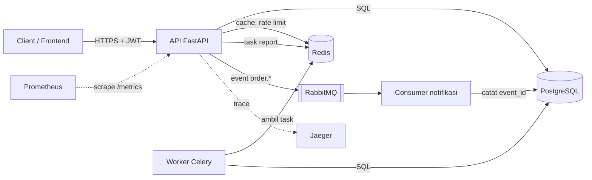

# Arsitektur Order API

## Komponen



| Komponen | Tanggung jawab |
|---|---|
| API | Menerima request, cek token dan scope, menjalankan use case |
| Worker Celery | Membuat report penjualan di background |
| Consumer notifikasi | Mengirim notifikasi dari event order, idempotent lewat `event_id` |
| PostgreSQL | Data produk, order, user, dan notifikasi yang sudah terkirim |
| Redis | Cache produk, rate limit, dan broker Celery |
| RabbitMQ | Event order (`order.placed`, `order.paid`, `order.cancelled`) |

## Layer kode

```
app/
  domain/          aturan bisnis: Order, Money, DiscountPolicy, User (tanpa library luar)
  application/     use case dan port: OrderService, AuthService, NotificationService
  infrastructure/  adapter: SQLAlchemy, Redis, RabbitMQ, JWT, Argon2, logging, metrics
  api/             FastAPI: router, schema, dependency, error handler
  worker/          Celery
  consumers/       consumer RabbitMQ
```

Dependency hanya mengarah ke dalam: `api` dan `infrastructure` boleh memakai `application` dan `domain`,
tetapi `domain` tidak tahu FastAPI, SQLAlchemy, maupun RabbitMQ.

## Alur: membuat order

1. Client mengirim `POST /orders` dengan header `Authorization: Bearer <token>`
2. `get_current_user` membaca token dan mengecek scope `orders:write`
3. `OrderService.place_order` mengurangi stok dan menyimpan order dalam satu transaksi (Unit of Work)
4. Setelah commit, event `order.placed` dikirim ke exchange `orders`
5. Consumer notifikasi menerima event, mengirim email, lalu ack
